<div align="center">


### KARADENİZ TEKNİK ÜNİVERSİTESİ
**Fen Bilimleri Enstitüsü • Yapay Zeka ve Veri Mühendisliği Yüksek Lisans Programı**  
*Multimodal Makine Öğrenmesi: Teori ve Uygulamalar*

---

# 🧠 Vision Transformer (ViT)
### *"An Image is Worth 16×16 Words: Transformers for Image Recognition at Scale"*
*(Dosovitskiy et al., Google Research, Brain Team — ICLR 2021)*

**Hazırlayan ve Sunan:** [Bedirhan Örseloğlu](https://github.com/bedirhanorseloglu)

[](https://react.dev/)
[](https://www.typescriptlang.org/)
[](https://tailwindcss.com/)
[](https://www.framer.com/motion/)
[](https://openreview.net/forum?id=YicbFdNTTy)

<br />


</div>

---

## 🎯 Proje ve Sunum Hakkında

Bu proje, bilgisayarlı görü (*Computer Vision*) dünyasında yıllarca süren **CNN (Evrişimli Sinir Ağları)** hakimiyetini kırarak **Transformer** mimarisini doğrudan görüntülere uygulayan çığır açıcı **Vision Transformer (ViT)** makalesinin interaktif, yüksek lisans düzeyinde akademik sunum uygulamasıdır.

Klasik statik slaytlar (PowerPoint/PDF) yerine **React + TypeScript + Framer Motion** ile geliştirilen bu interaktif sunum; **19 modüler slayt**, **4 özel kontrollü yüksek çözünürlüklü animasyon videosu**, **büyütülebilir (Lightbox) mimari diyagramlar** ve **adım adım matematiksel/pedagojik açıklamalar** içerir.

---

## 🖼️ Sunumdan Görsel Kesitler ve Temel Konular

### 1️⃣ Geleneksel RNN Darboğazından Attention ve Transformer'a Geçiş
Geleneksel Seq2Seq RNN mimarilerinde tüm cümlenin tek bir sabit boyutta vektöre sıkıştırılması (*Information Bottleneck*) yerine, **Attention** mekanizmasının dinamik ağırlıklarla ($\alpha$) nasıl odaklandığı ve **Transformer** mimarisinin **Q, K, V (Query, Key, Value)** matrisleriyle nasıl paralel çalıştığı adım adım incelenir.

<div align="center">
  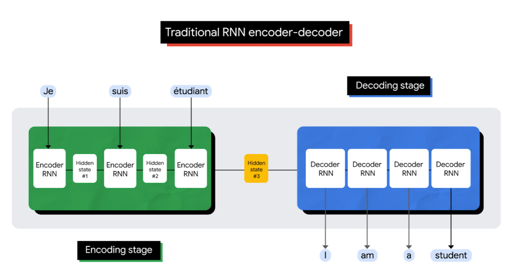
  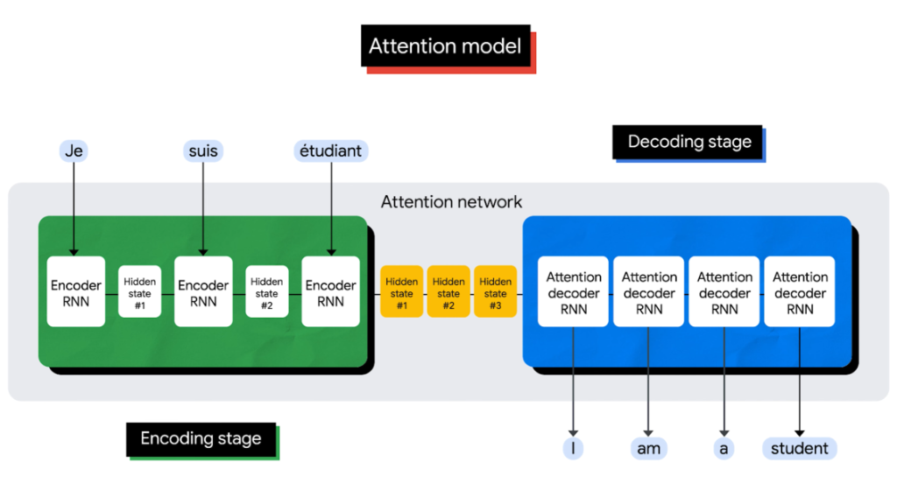
</div>

---

### 2️⃣ Vision Transformer (ViT) Mimarisi: 5 Temel Adım
Bir görüntünün (`224×224×3`) standart bir NLP Transformer Encoder'a nasıl beslendiği 5 net adımda görselleştirilir:
1. **Patch'lere Bölme:** Görüntü `16×16` piksellik **196 adet patch**'e (görsel kelimeye) ayrılır.
2. **Linear Projection (Patch Embedding):** Her bir patch (`16×16×3 = 768`), doğrusal katman veya eşdeğer `Conv2d(kernel_size=16, stride=16)` ile `196×768` boyutlu embedding matrisine dönüştürülür.
3. **`[CLS]` Token & 1D Position Embedding:** BERT mimarisine sadık kalınarak en başa öğrenilebilir bir `[CLS]` token (`1×768`) eklenir (`197×768`) ve uzamsal sırayı öğretmek için her vektöre **1D Position Embedding** toplanır.
4. **Transformer Encoder:** Çok Başlı Öz-Dikkat (*Multi-Head Self-Attention*), *LayerNorm*, *Skip-Connections* ve *MLP* bloklarından geçerek tüm patch'ler birbiriyle küresel (*global*) olarak haberleşir.
5. **MLP Head (Sınıflandırma):** Encoder çıkışındaki nihai `[CLS]` temsili (`z_L^0`), sınıf olasılıklarını üretmek üzere **MLP Head** katmanına aktarılır.

<div align="center">
  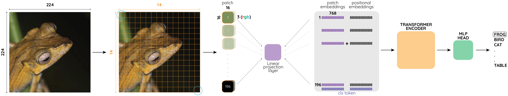
</div>

<div align="center">
  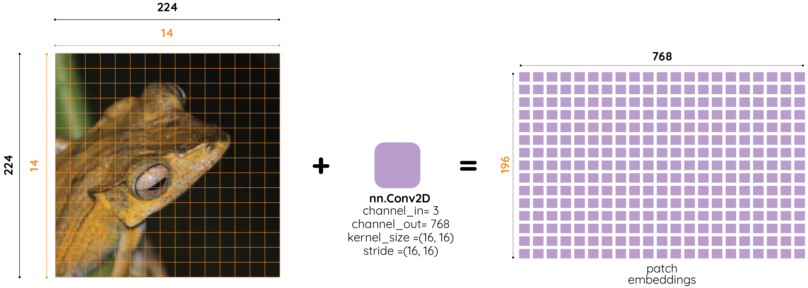
  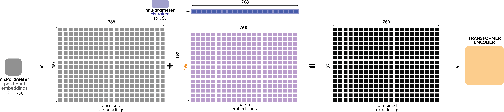
</div>

---

### 3️⃣ CNN vs. ViT: Alıcı Alanı (Receptive Field) ve Inductive Bias İkilemi
* **Doku (Texture) vs. Şekil (Shape):** CNN'ler küçük yerel filtrelerle (*local receptive field*) baktığı için **doku (texture)** odaklıdır; ViT ise ilk katmandan itibaren görüntünün tamamına (*global receptive field*) odaklandığı için insan gözü gibi **şekil ve bütünlük (shape)** odaklıdır.
* **Inductive Bias (Mimari Ön Varsayım) İkilemi:** CNN'in doğasında bulunan **yerellik (*locality*)** ve **öteleme eşdeğerliliği (*translation equivariance*)** kuralları ViT'te hazır olarak verilmez.
  * 🔴 **Dezavantaj:** Küçük/orta ölçekli veri setlerinde (*ImageNet-1K*) sıfırdan eğitildiğinde ViT iyi genelleme yapamaz ve CNN'in gerisinde kalır.
  * 🟢 **Avantaj:** Devasa veri setlerinde (*JFT-300M, ImageNet-21K*) katı mimari kurallarla kısıtlanmadığı için çok daha esnek öğrenir ve CNN'leri geride bırakır.

<div align="center">
  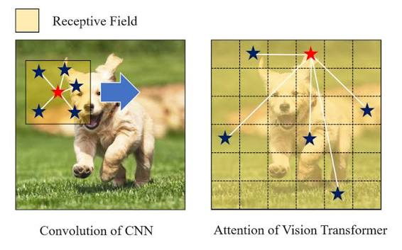
  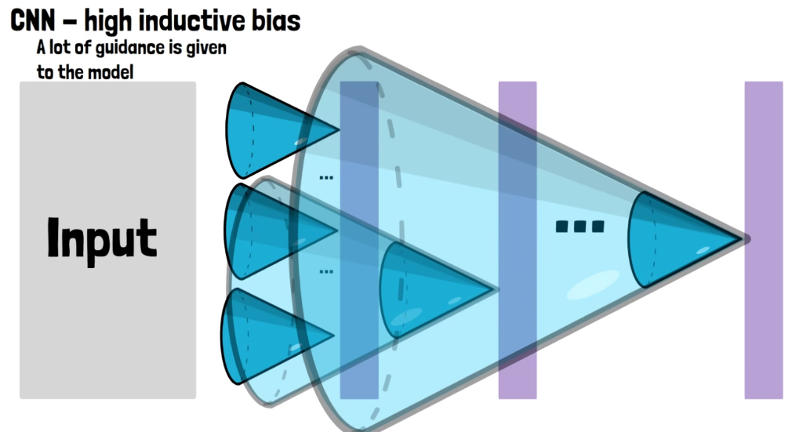
</div>

<br />

<div align="center">
  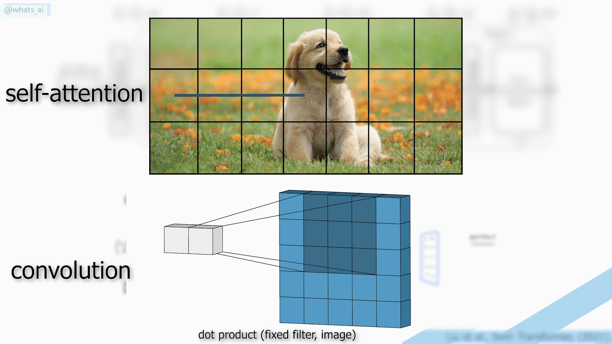
</div>

---

### 4️⃣ Dikkat Haritaları (Attention Maps), Model Varyantları ve Gelecek Çalışmalar
* **Dikkat Haritaları (Şekil 6):** ViT, kendisine hiçbir piksel/bölütlenme (*segmentation*) etiketi verilmemesine rağmen arka planı karartıp doğrudan ana nesneye odaklanmayı kendi kendine öğrenir.
* **Model Varyantları (Tablo 1):** `ViT-Base (86M)`, `ViT-Large (307M)` ve `ViT-Huge (632M)` modellerinin katman, boyut ve hesaplama maliyeti analizleri.
* **Ana Sonuç & Gelecek Hedefler:** Büyük veride *pre-training* yapılıp hedef veri kümelerine (*ImageNet, CIFAR-100, VTAB*) *fine-tuning* ile aktarıldığında ViT, en gelişmiş CNN'leri çok daha az hesaplama maliyetiyle geçer.

<div align="center">
  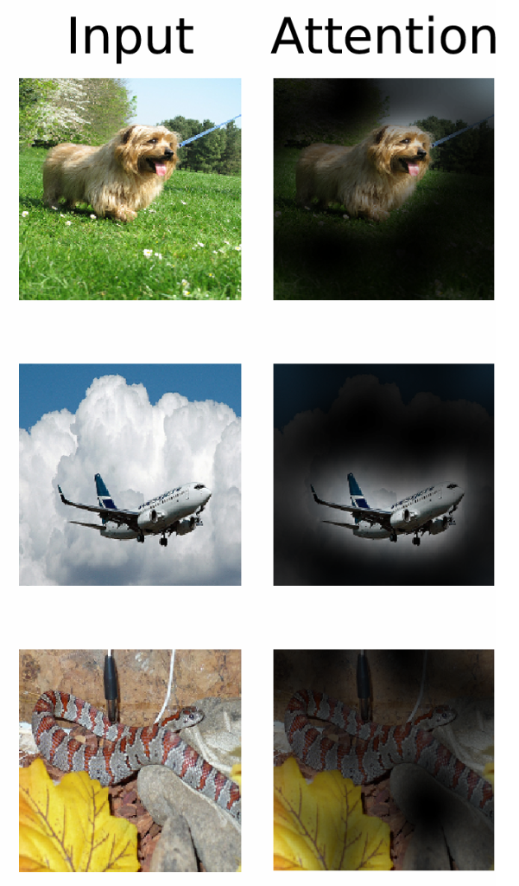
  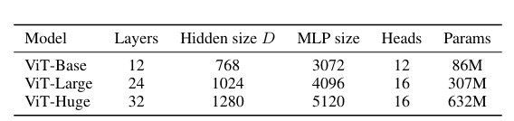
</div>

<br />

<div align="center">
  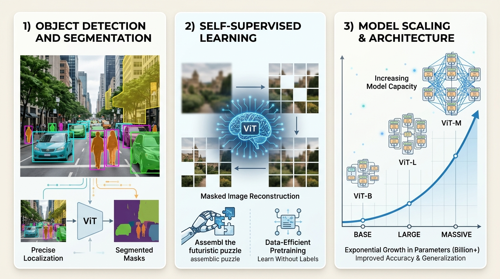
</div>

---

## 📑 Sunum Akışı (19 İnteraktif Slayt)

| Slayt | Bölüm | Başlık | İçerik & Etkileşim |
| :---: | :--- | :--- | :--- |
| **01** | Giriş | **Kapak** | KTÜ Kurumsal Başlık & Makale Künyesi |
| **02** | Bölüm 1 | **Geleneksel RNN vs. Attention** | Sabit Vektör Darboğazı (*Bottleneck*) vs. Dinamik Hafıza |
| **03** | Bölüm 1 | **Attention Mekanizması Nasıl Çalışır?** | 🎬 İnteraktif Video: $\alpha$ Ağırlıkları, Context Vektörü ($A$) |
| **04** | Bölüm 1 | **Uygulamalı Örnek: Çeviri ve Attention** | 🎬 İnteraktif Video: Kelime Hizalama ve Odaklanma |
| **05** | Bölüm 2 | **Transformer Mimarisi: Paralel İşleme** | 🎬 İnteraktif Video: RNN'siz Paralel Encoder-Decoder Yığını |
| **06** | Bölüm 2 | **Self-Attention: QKV ve Çok Başlı Dikkat** | 🎬 İnteraktif Video: Query, Key, Value ve $h=8$ Multi-Head Attention |
| **07** | Bölüm 3 | **Neden Vision Transformer? (ViT'in Doğuşu)** | $O(N^2)$ Piksel Tuzağı ve $16\times16$ Patch Devrimi |
| **08** | Bölüm 3 | **ViT Mimarisi: 5 Temel Adıma Genel Bakış** | Google Research Animasyonu & 5 Adımlı Uçtan Uca Akış |
| **09** | Bölüm 3 | **1. ve 2. Adım: Patch Bölme & Embedding** | `196×768` Matrisi & 🔍 `Conv2d` Kanıtı Lightbox Modalı |
| **10** | Bölüm 3 | **3, 4 ve 5. Adım: `[CLS]`, Position & MLP** | `197×768` Matrisi, *Out-of-the-Box* NLP Mirası & 🔍 Dikkat Haritası |
| **11** | Bölüm 3 | **3. Adım Detayı: `[CLS]` ve 1D Position** | Neden 2D Değil de 1D Position Embedding Yeterli? (`14×14` Izgara) |
| **12** | Bölüm 3 | **CNN vs. ViT: Alıcı Alanı ve Görsel Algı** | 🎬 İnteraktif Video: Yerel Doku (*Texture*) vs. Küresel Şekil (*Shape*) |
| **13** | Bölüm 3 | **CNN vs. ViT: Inductive Bias Farkı** | Katı Mimari Rehberlik vs. Serbest Öğrenme (Dezavantaj & Avantaj) |
| **14** | Bölüm 3 | **Neden 16×16 Patch? Karesel Maliyet $O(N^2)$** | 🎬 İnteraktif Video: Çözünürlük Patlaması & Yüksek Çözünürlüklü Fine-Tuning |
| **15** | Bölüm 4 | **Hangi Veride CNN, Hangi Veride ViT?** | Veri Ölçeğine Göre Mimari Seçimi ve Pratik *Fine-Tuning* Kuralı |
| **16** | Bölüm 4 | **ViT Model Varyantları: Base, Large, Huge** | Tablo 1 Parametreleri (`ViT-B/16`, `ViT-L/16`, `ViT-H/14`) |
| **17** | Bölüm 5 | **Sonuç ve Gelecek Çalışmalar** | Ana Sonuç, Hesaplama Tasarrufu ve 3 Açık Araştırma Hedefi |
| **18** | Bölüm 6 | **Kaynakça ve Referanslar** | APA 7 Formatında 11 Akademik Makale, Resmi Kod ve İnteraktif Araç |
| **19** | Kapanış | **Teşekkürler & Canlı Yarışma** | Soru-Cevap (Q&A) ve QR Kodlu Canlı Bilgi Yarışması |

---

## 🚀 Kurulum ve Çalıştırma

Projeyi bilgisayarınızda yerel olarak çalıştırmak için:

```bash
# 1. Depoyu klonlayın
git clone https://github.com/bedirhanorseloglu/Vision-Transformer-Sunu.git

# 2. Proje dizinine gidin
cd Vision-Transformer-Sunu

# 3. Bağımlılıkları yükleyin
npm install

# 4. Geliştirme sunucusunu başlatın
npm run dev
```

Tarayıcınızda `http://localhost:5173` adresini açarak sunumu tam ekran deneyimleyebilirsiniz.

### ⌨️ Sunum Kısayolları
* ` Sağ Ok (→) ` / ` Boşluk (Space) ` : Sonraki Slayt
* ` Sol Ok (←) ` : Önceki Slayt
* ` F ` : Tam Ekran (Fullscreen) Modu Aç/Kapat
* ` ESC ` : Açık Görsel Modallarını (Lightbox) veya Tam Ekranı Kapat

---

## 📚 Temel Kaynaklar (APA 7)

1. **Dosovitskiy, A., Beyer, L., Kolesnikov, A., Weissenborn, D., Zhai, X., Unterthiner, T., ... & Houlsby, N. (2021).** *An Image is Worth 16x16 Words: Transformers for Image Recognition at Scale*. International Conference on Learning Representations (ICLR 2021). https://openreview.net/forum?id=YicbFdNTTy
2. **Vaswani, A., Shazeer, N., Parmar, N., Uszkoreit, J., Jones, L., Gomez, A. N., ... & Polosukhin, I. (2017).** *Attention Is All You Need*. Advances in Neural Information Processing Systems (NeurIPS 2017). https://arxiv.org/abs/1706.03762
3. **Google Research. (2020).** *Vision Transformer and MLP-Mixer Architectures* [Computer software]. GitHub. https://github.com/google-research/vision_transformer
4. **Google Research. (2020).** *Transformers for Image Recognition at Scale*. Google Research Blog. https://research.google/blog/transformers-for-image-recognition-at-scale/

---

<div align="center">
  <sub><b>Karadeniz Teknik Üniversitesi</b> • Yapay Zeka ve Veri Mühendisliği Yüksek Lisans Programı kapsamında <b>Bedirhan Örseloğlu</b> tarafından hazırlanmıştır.</sub>
</div>
